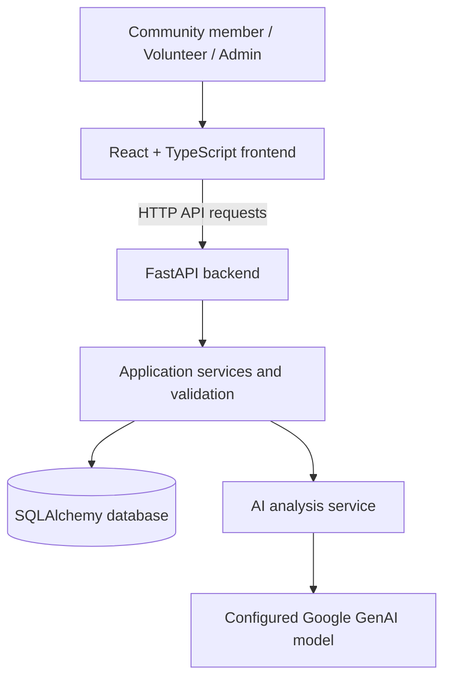

# Socio-Hub

**A community problem reporting and resolution platform**

Socio-Hub is a web application intended to help community members report local problems and connect those reports with volunteers and administrators who can coordinate their resolution. This repository contains a React frontend and a FastAPI backend, with database and AI-assisted analysis components.

> **Project status:** This README describes the reported project setup. Features such as image uploads, live AI analysis, persistent cloud storage, and end-to-end admin synchronization should be verified in the current code and deployment before being presented as production-ready.

## Contents

- [Overview](#overview)
- [Features](#features)
- [Technology stack](#technology-stack)
- [Architecture](#architecture)
- [Repository structure](#repository-structure)
- [Getting started](#getting-started)
- [Environment configuration](#environment-configuration)
- [Running the application](#running-the-application)
- [Testing](#testing)
- [API documentation](#api-documentation)
- [Deployment](#deployment)
- [Security and limitations](#security-and-limitations)
- [Contributing](#contributing)
- [License](#license)

## Overview

Communities often need a straightforward way to report problems, make those problems visible, and coordinate responses. Socio-Hub is designed around a report lifecycle: a community member submits a problem, the application stores it, and volunteers or administrators can review and manage the report.

## Features

The repository has been described as containing the following application areas. Verify each flow in the running app before relying on it for a live demonstration:

- **Community reporting:** submit a report describing a community problem.
- **Problem categories and priority:** organize reports using the categories and priority values supported by the backend schemas.
- **Volunteer workflow:** provide a volunteer-facing area for reviewing or handling work.
- **Admin portal:** provide an administrative area for viewing and managing reports.
- **AI-assisted analysis:** backend integration intended to analyze problem descriptions using a configured Google GenAI/Gemma model.
- **REST API:** FastAPI endpoints for application features.
- **Database layer:** SQLAlchemy with SQLite in the local development setup.

Image upload, report synchronization between community and admin views, cloud persistence, and live AI availability must be tested in the current environment; they are not guaranteed by a successful frontend build or unit-test run alone.

## Technology stack

| Layer | Technology |
|---|---|
| Frontend | React, TypeScript, Vite |
| Frontend routing and icons | React Router, Lucide React |
| Backend | Python, FastAPI |
| Database access | SQLAlchemy |
| Local development database | SQLite |
| AI integration | Google GenAI SDK with a configured model |
| Testing | Pytest for backend tests |

Check `frontend/package.json` and `backend/requirements.txt` for the exact versions and dependencies used by the current checkout.

## Architecture



The diagram is a conceptual view. Confirm actual endpoints, authentication behavior, and storage implementation against the code before deployment.

## Repository structure

The project is organized into frontend and backend directories. The following is a guide to the expected major areas; exact files may vary by branch.

```text
Socio-hub/
├── frontend/                 # React + TypeScript + Vite application
│   ├── src/
│   │   ├── components/       # Reusable UI components
│   │   ├── pages/            # Application pages
│   │   └── services/         # API client and frontend services
│   ├── package.json
│   └── vite.config.ts
├── backend/                  # FastAPI application
│   ├── app/
│   │   ├── ai/               # AI integration
│   │   ├── core/             # Shared configuration/security
│   │   ├── db/               # Database setup
│   │   ├── routers/          # API routes
│   │   ├── schemas/          # Request/response schemas
│   │   └── services/         # Business logic
│   ├── tests/
│   ├── requirements.txt
│   └── .env.example
└── README.md
```

## Getting started

### Prerequisites

Install:

- Python 3.11 or another version supported by the backend dependencies.
- Node.js and npm compatible with the Vite version in `frontend/package.json`.
- Git.

### 1. Clone the repository

```bash
git clone https://github.com/shivxdev/Socio-hub.git
cd Socio-hub
```

To use the integration branch, if it is still the branch containing the latest combined work:

```bash
git checkout integration/phase-6
git pull origin integration/phase-6
```

### 2. Set up the backend

From the repository root, on Windows PowerShell:

```powershell
cd backend
python -m venv .venv
.\.venv\Scripts\Activate.ps1
python -m pip install --upgrade pip
pip install -r requirements.txt
```

Create a local environment file using the example if it exists:

```powershell
Copy-Item .env.example .env
```

If `.env.example` is not present in the current backend directory, inspect the configuration files and create `backend/.env` with the variable names the application actually reads. Do not guess variable names.

### 3. Set up the frontend

Open a second terminal from the repository root:

```powershell
cd frontend
npm install
```

Create `frontend/.env.local` (or the environment file expected by the frontend setup) with the API base URL:

```dotenv
VITE_API_BASE_URL=http://localhost:8000/api/v1
```

The frontend configuration must match the API client implementation. If the client already appends `/api/v1` internally, use the base URL format expected by that client to avoid duplicating the path.

## Environment configuration

Use local environment files for secrets and machine-specific settings. Never commit `.env`, API keys, access tokens, or service-account files.

| Variable | Purpose |
|---|---|
| `VITE_API_BASE_URL` | Frontend API base URL; use the exact format expected by `frontend/src/services/apiClient.ts`. |
| `GEMINI_API_KEY` | Secret key for the configured Google GenAI integration, if this variable is read by the current backend code. |
| `GEMINI_MODEL_ID` | Model identifier used by the AI service, if configured in the current code. |
| `GEMINI_TIMEOUT_SECONDS` | Optional timeout for AI requests, if supported by the current configuration. |

The names above reflect the previously reported configuration and must be checked against the current source code and `.env.example`. Set a valid model ID supported by the provider and account. Do not put server-side AI keys in any `VITE_*` variable, because Vite variables are exposed to browser code.

### Authentication

The current development setup has been reported to use a working login flow without Firebase Authentication being active. Do not assume that frontend login alone protects backend routes. Before public deployment, verify that the backend independently authenticates requests and enforces community, volunteer, and admin permissions. Do not describe Firebase Authentication as enabled unless it is actually configured and verified.

## Running the application

### Start the backend

From the repository root:

```powershell
cd backend
.\.venv\Scripts\Activate.ps1
python -m uvicorn app.main:app --reload --port 8000
```

If the virtual environment already exists, you can run this directly from the repository root:

```powershell
.\backend\.venv\Scripts\python.exe -m uvicorn app.main:app --reload --port 8000
```

### Start the frontend

In a second terminal:

```powershell
cd frontend
npm run dev
```

Open the local URL printed by Vite, commonly `http://localhost:5173`.

### Health check

If the health endpoint is enabled in the current backend:

```text
http://localhost:8000/health
```

## Testing

### Backend tests

From the repository root, if the existing Windows virtual environment is available:

```powershell
.\backend\.venv\Scripts\python.exe -m pytest backend\tests\ -q --ignore=backend\tests\smoke_test_live.py
```

Or activate the backend virtual environment and run:

```bash
python -m pytest tests/ -q --ignore=tests/smoke_test_live.py
```

The live smoke test may require valid provider credentials and should only be run when deliberately testing the live integration.

### Frontend production build

```powershell
cd frontend
npm run build
```

A passing build checks compilation and bundling; it does not prove that API calls, authentication, uploads, or deployment work end to end.

### Suggested manual smoke test

1. Open the application and sign in using the configured development login.
2. Submit a report without an image.
3. Submit a report with an allowed image.
4. Confirm both reports can be retrieved from the backend.
5. Open the admin portal and verify that new reports appear after refresh.
6. Verify role restrictions on backend endpoints.
7. If AI analysis is configured, test it separately and confirm ordinary report submission still works when AI is unavailable.

## API documentation

When the backend is running locally, FastAPI commonly provides interactive API documentation at:

- Swagger UI: `http://localhost:8000/docs`
- ReDoc: `http://localhost:8000/redoc`

These URLs depend on the documentation routes being enabled in the current backend configuration. Use the actual router definitions and OpenAPI document as the source of truth for available endpoints.

## Deployment

A possible deployment arrangement is:

- **Frontend:** Vercel
- **Backend:** Render or another host that supports Python web services
- **Database:** a persistent disk or managed database compatible with the application's database layer
- **Image storage:** persistent disk or object storage

These are deployment recommendations, not a claim that Socio-Hub is already deployed.

### Frontend deployment

1. Import the GitHub repository into Vercel.
2. Set the frontend root directory to `frontend`.
3. Set the production `VITE_API_BASE_URL` to the deployed backend API base URL, matching the frontend API client's path handling.
4. Build using the command in `frontend/package.json` (reported as `npm run build`).
5. Set the output directory to `dist`.
6. Configure SPA rewrites if required for client-side routes.
7. Redeploy after changing environment variables.

### Backend deployment

1. Create a Python web service connected to the repository.
2. Set the backend root directory or configure commands for the repository layout.
3. Install dependencies from `backend/requirements.txt`.
4. Start the service using the platform's required host and port configuration. For example, a platform that provides a `PORT` environment variable may use a command similar to:

   ```bash
   uvicorn app.main:app --host 0.0.0.0 --port $PORT
   ```

   Confirm the working directory and port syntax for the chosen host before using this command.

5. Configure required environment variables through the hosting provider's dashboard.
6. Configure CORS to allow the exact deployed frontend origin.
7. Verify the health endpoint and inspect server logs.

### Persistence warning

Do not assume that local SQLite files or files uploaded to a local directory will persist on a cloud host. Some hosts use ephemeral filesystems. Configure a persistent disk or migrate to a suitable managed database and object-storage service before relying on production report or image persistence. If SQLite is used on a mounted disk, ensure the database path points to that disk and that the deployment supports the intended write pattern.

### Production checklist

- [ ] Backend health endpoint responds successfully.
- [ ] Frontend points to the deployed API.
- [ ] CORS allows the deployed frontend origin.
- [ ] Required environment variables are configured securely.
- [ ] Database data survives restarts and redeployments.
- [ ] Uploaded images remain accessible after restart.
- [ ] Login and backend role checks are verified.
- [ ] Community reports appear in the admin portal.
- [ ] AI calls work with valid provider credentials and fail safely without them.
- [ ] No secrets are committed to Git.

## Security and limitations

- Never commit API keys, passwords, tokens, `.env` files, or private credentials.
- Treat any API key pasted into chats, source control, screenshots, or public logs as exposed; revoke or rotate it.
- Validate uploaded file types and sizes on the server, and do not trust user-supplied filenames.
- Enforce access control in the backend, not only by hiding frontend pages.
- Configure CORS narrowly for the required origins.
- Verify database and upload persistence before production use.
- Confirm the configured model identifier and provider compatibility before enabling live AI features.
- The current login implementation, image upload behavior, admin synchronization, and production storage must be verified against the current code and deployment.

## Contributing

1. Create a feature branch.
2. Make a focused change.
3. Run relevant backend tests and the frontend build.
4. Review the diff and ensure no secrets or generated artifacts are included.
5. Open a pull request with a summary and testing notes.

## License

No license is specified here. Add a `LICENSE` file and update this section only after the project maintainers choose a license.
